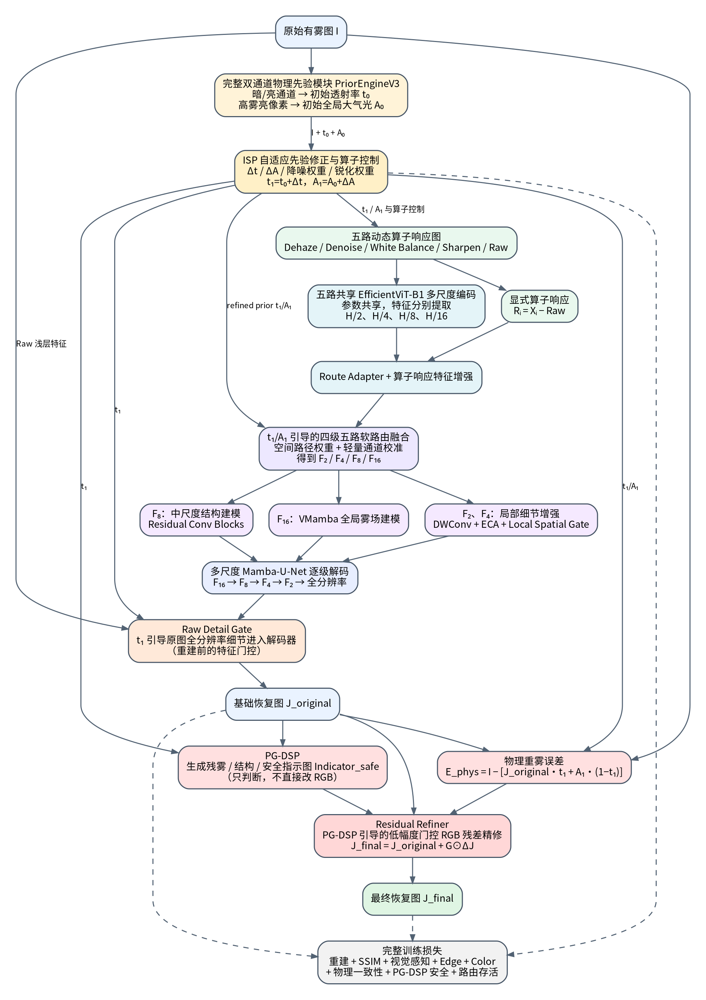

# PMRD-Net

**Physics-Prior-Guided Multi-Response Dynamic Network for Single Image Dehazing**

This repository provides the implementation and evaluation resources of PMRD-Net, a physics-prior-guided multi-response dynamic network for single-image dehazing.

PMRD-Net combines complementary physical-prior calibration, dynamic multi-response routing, transmission-gated progressive reconstruction, and physics-guided structure-preserving refinement.


[中文说明](README.zh-CN.md) · [Installation](docs/INSTALL.md) ·
[Datasets](docs/DATASETS.md) · [Checkpoints](checkpoints/README.md) ·
[GitHub upload](docs/GITHUB_UPLOAD.zh-CN.md)



This repository was organized from `PMRD-Net_FINAL_FULL_20260812.tar.gz`.
All model and loss implementation files are preserved verbatim. The active
training/evaluation drivers have portable default paths; old checkpoint
cleanup requires an explicit flag. All original entrypoints remain in
`legacy/original_entrypoints/`.

## Included implementation

- Initial transmission and atmospheric light from `PriorEngineV3`.
- Pixel-wise physical calibration and Dehaze / Denoise / White Balance /
  Sharpen / Raw response images.
- Shared EfficientViT-B1 multi-scale features and physics-conditioned routing.
- VMamba context at H/16, a multi-scale decoder, Raw Detail Gate,
  PG-DSP indicators and bounded RGB residual refinement.
- Composite restoration loss, five-dataset fine-tuning, and the original
  six-dataset/eight-protocol evaluator with PSNR, SSIM, NIQE and BRISQUE.

The archive provides a general checkpoint but **does not contain a standalone
general pretraining driver**. `finetune.py` starts from that checkpoint;
`legacy/original_entrypoints/train_integration_example.py` is only a loop
integration fragment.

## Quick start

Install PyTorch and dependencies following [INSTALL.md](docs/INSTALL.md),
then merge the separate model-weight asset into this folder.

```bash
python tools/verify_weights.py
python tools/check_environment.py --require-cuda --require-weights
python smoke_test.py
```

For formal runs the smoke test must show `backbone fallback: False` and
`Mamba enabled: True`. A CPU fallback only validates shapes and loss wiring.

Materialize the supplied split membership for your local image directories:

```bash
python tools/prepare_splits.py --data-root /path/to/datasets --check-files
python finetune.py --dataset ihaze --check_only
python finetune.py --dataset ihaze --amp
```

Evaluate a fixed protocol:

```bash
python evaluate.py --datasets I-HAZE --protocols tile512_stride256 --save_images
```

See [REPRODUCIBILITY.md](docs/REPRODUCIBILITY.md) for the complete protocol
list and limitations. `--protocols all` reproduces the archived protocol
sweep; its best-on-test summary is exploratory rather than an unbiased
single-protocol benchmark. Select a protocol independently for formal reporting.

## Repository layout

```text
PMRD-Net/
├── finetune.py / evaluate.py / smoke_test.py
├── PMRD-Net_complete_general.py   # original single-file model and loss
├── future_process/              # original modular implementation
├── generate_prior/ / isp/
├── tools/                       # splits, environment and integrity checks
├── data/splits/                 # original split membership, portable paths
├── checkpoints/                 # weight manifest; binaries are separate
├── reports/                     # original history and split audit
├── docs/ / configs/ / tests/
└── legacy/                      # preserved original entrypoints
```

## Release assets

| Asset | Contents |
| --- | --- |
| `PMRD-Net_GitHub_Repository.zip` | Code, docs, splits, history and checks |
| `PMRD-Net_Model_Weights.zip` | Backbone + general best + five model-only checkpoints |
| `PMRD-Net_Training_Archive.zip` | Original remaining best/latest states and general pairing reports |

Extract the repository ZIP for a GitHub code upload. Publish large weight
assets through GitHub Releases; do not commit the ZIPs or checkpoints to Git.

## Verification and license

Preparation checks cover Python syntax, CLI defaults, unchanged core-file
hashes, split membership, weight hashes and ZIP integrity. The preparation
host has no PyTorch/CUDA; a GPU forward/backward run and metric reproduction
have not been performed. See [VALIDATION.md](docs/VALIDATION.md).

Third-party notices and licenses are included. The original archive supplied
no project-wide license; see [THIRD_PARTY_NOTICES.md](THIRD_PARTY_NOTICES.md).
